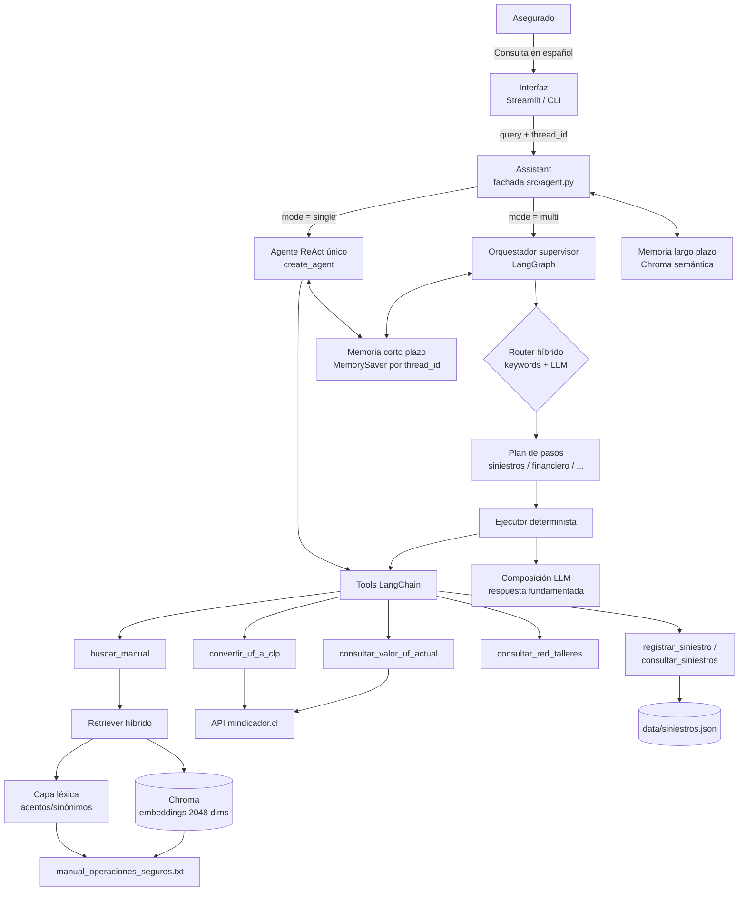
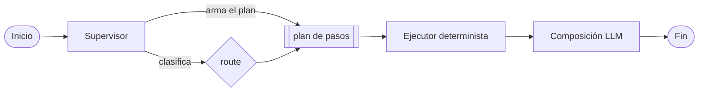
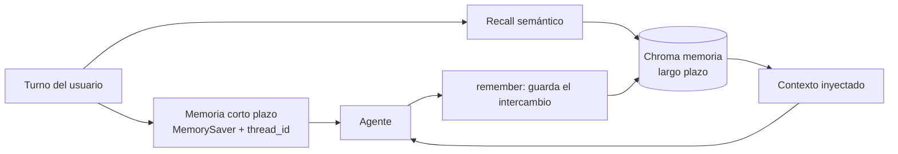

# Arquitectura del Asistente Inteligente de Seguros — Seguros Express

Este documento describe la arquitectura de agentes (RA2) que evoluciona el
pipeline RAG de la Evaluación Parcial 1. Se prioriza la **orquestación
multi-agente**, la **memoria** y la **recuperación híbrida con embeddings**.

## 1. Vista general



## 2. Orquestación multi-agente (plan → execute)



- **Supervisor:** es el primer nodo del grafo. (1) Clasifica la consulta con un
  *router híbrido*; (2) arma un **plan** de pasos. Una consulta compuesta como
  "registra un choque de la patente ABCD12 y dime el deducible en pesos" produce
  `["siniestros", "financiero"]`.
  1. **Reglas deterministas** por palabras clave con prioridad (más fiables y
     explicables): `financiero` > `coberturas` > `siniestros` > `reembolsos`,
     y disparadores de **escritura** (`registra`, `denuncia`, ...).
  2. **LLM con salida estructurada** (`RouteDecision`, Pydantic) solo para
     consultas ambiguas.
  Los mensajes de seguimiento cortos ("¿y eso en pesos?") se combinan con el
  turno anterior para conservar el contexto.
- **Ejecutor determinista:** recorre el plan e **invoca las herramientas por
  código** (no delega el *tool calling* al LLM), reuniendo los datos en un
  contexto. Esto es fiable y rápido con modelos locales.
- **Composición:** una única llamada al LLM redacta la respuesta final usando
  **solo** los datos recuperados (anti-alucinación); el protocolo `{...}` de
  herramientas se descarta vía `sanitize_answer`.

| Paso del plan | Dominio | Herramientas que dispara |
|---|---|---|
| `coberturas` | Qué cubre / qué no cubre | `buscar_manual` |
| `siniestros` | Protocolo, denuncia, grúa, talleres, **escritura** | `buscar_manual`, `consultar_red_talleres`, `registrar_siniestro` |
| `reembolsos` | Reembolsos, primas, vigencia | `buscar_manual` |
| `financiero` | Montos en UF/CLP | `buscar_manual`, `consultar_valor_uf_actual`, `convertir_uf_a_clp` |
| `general` | Saludos y consultas generales | `buscar_manual` |

> El modo **agente único** conserva el patrón ReAct clásico (`create_agent` con
> *tool calling*) para comparar ambos enfoques en la demo.

## 3. Recuperación híbrida (RAG con embeddings)

```mermaid
flowchart TD
    Q[Consulta] --> LEX[Búsqueda léxica<br/>normalización + stopwords<br/>+ raíces + sinónimos]
    Q --> EMB[Embedding (OpenAI-compatible)]
    EMB --> VS[(Chroma persistente<br/>data/chroma · coseno)]
    VS --> FILT[Filtro por score<br/>threshold 0.30]
    LEX --> FUSE[Fusión]
    FILT --> FUSE
    FUSE --> CTX[Contexto para el agente<br/>o vacío si no hay coincidencias]
```

1. **Chunking:** secciones del manual → `RecursiveCharacterTextSplitter`
   (`CHUNK_SIZE=700`, `CHUNK_OVERLAP=120`).
2. **Indexación:** cada *chunk* se embebe con el `EMBEDDING_MODEL` configurado
   (endpoint OpenAI-compatible) y se persiste en Chroma. El índice se reconstruye
   solo si cambia el manual o el modelo de embeddings (*fingerprint* SHA-256).
3. **Búsqueda:** similitud coseno con umbral (`VECTOR_SCORE_THRESHOLD=0.30`)
   para descartar fragmentos fuera de dominio.
4. **Fusión:** prioridad léxica (códigos exactos) + relleno vectorial, con
   deduplicación. Sin coincidencias → lista vacía (**anti-alucinación**).

## 4. Memoria



| Tipo | Implementación | Alcance |
|---|---|---|
| **Corto plazo** | `MemorySaver` (LangGraph) por `thread_id` | Sesión actual |
| **Corto plazo (buffer)** | `ConversationBufferWindowMemory` | Ventana de N turnos, persistida |
| **Largo plazo** | `LongTermMemory` (Chroma + embeddings) | Entre sesiones, por significado |

## 5. Flujo de ejecución

1. El asegurado escribe en la web o la CLI (con un `thread_id` de sesión).
2. El **Assistant** elige el modo (multi-agente por defecto).
3. En multi-agente, el **supervisor** clasifica y arma un **plan** de pasos.
4. El **ejecutor determinista** invoca las **herramientas** del plan (RAG
   híbrido, valor/conversión UF, talleres y/o **registro de siniestros**).
5. Se recupera memoria de **largo plazo** relevante y se inyecta como contexto.
6. La **composición** (LLM) redacta una respuesta fundamentada con los datos
   recuperados (o declara que no tiene la información).
7. El turno se guarda en la memoria de **corto** y **largo** plazo.

## 6. Decisiones de diseño

| Decisión | Justificación |
|---|---|
| **Chat con proveedor conmutable** | `PROVIDER` elige entre **Ollama** local (`qwen2.5:14b-instruct`, offline, sin coste) y **NVIDIA NIM** remoto (`openai/gpt-oss-20b`), ambos vía interfaz compatible con OpenAI. |
| **NVIDIA NIM para embeddings** | Una sola API key (gratuita), endpoint compatible con OpenAI y embeddings multilingües de 2048 dims (`nvidia/llama-nemotron-embed-vl-1b-v2`), en espacio coseno. |
| **Chroma persistente** | Base vectorial simple de operar, con persistencia en disco y soporte de LangChain (`langchain-chroma`). |
| **Recuperación híbrida** | Los embeddings capturan paráfrasis; la capa léxica preserva códigos exactos (teléfonos, `5 UF`) y el comportamiento anti-alucinación. |
| **Router híbrido** | Las reglas deterministas son fiables y explicables para los casos frecuentes; el LLM resuelve la ambigüedad. |
| **Ejecutor determinista (plan → execute)** | Invocar las herramientas por código (en vez de *tool calling* del LLM) garantiza fiabilidad y baja latencia con modelos locales pequeños, y hace la traza de ejecución reproducible y explicable. |
| **Herramienta de escritura** | `registrar_siniestro`/`consultar_siniestros` permiten acciones con efecto (folios persistentes en `data/siniestros.json`), evidenciando autonomía con herramientas de escritura (IE1). |
| **Composición separada** | Una sola llamada final al LLM dedicada a redactar con los datos recuperados reduce la alucinación y separa "obtener datos" de "explicar". |
| **LangGraph (no CrewAI)** | El entorno es Python 3.14 y CrewAI exige <3.14. LangGraph ya está disponible y cubre el patrón supervisor. |
| **Dos memorias** | La de corto plazo da continuidad en la sesión; la de largo plazo recupera información por significado entre sesiones. |
