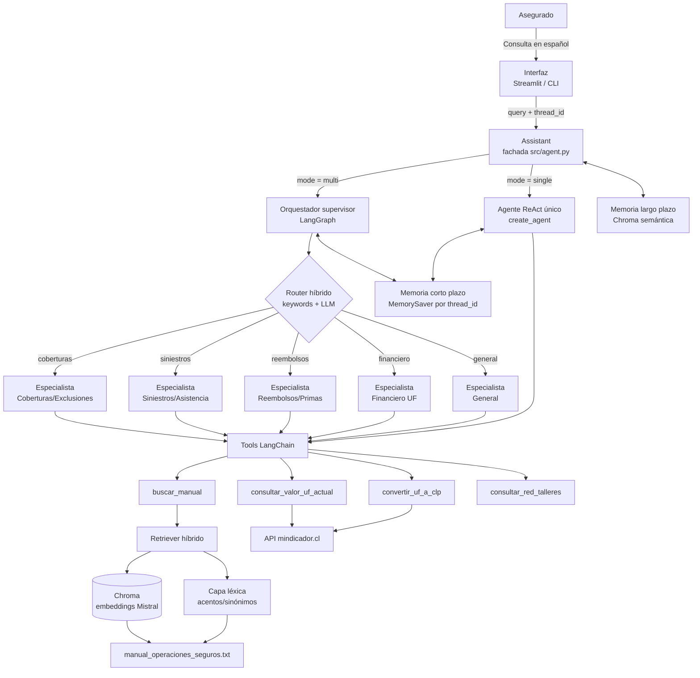
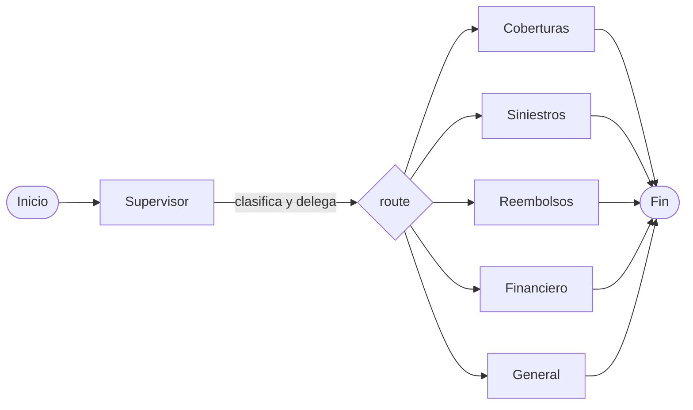
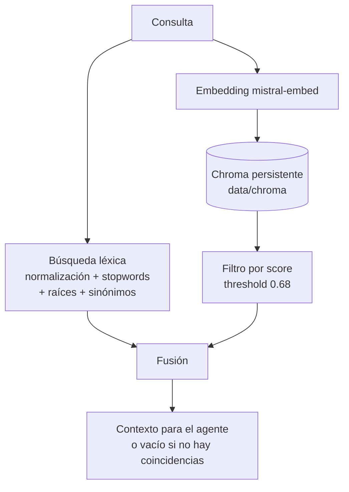
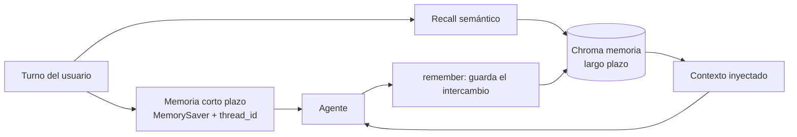

# Arquitectura del Asistente Inteligente de Seguros — Seguros Express

Este documento describe la arquitectura de agentes (RA2) que evoluciona el
pipeline RAG de la Evaluación Parcial 1. Se prioriza la **orquestación
multi-agente**, la **memoria** y la **recuperación híbrida con embeddings**.

## 1. Vista general

## 2. Orquestación multi-agente (supervisor + especialistas)

- **Supervisor:** nodo que decide el especialista. Usa un *router híbrido*:
  1. **Reglas deterministas** por palabras clave con prioridad (más fiables y
     explicables): `financiero` > `coberturas` > `siniestros` > `reembolsos`.
  2. **LLM con salida estructurada** (`RouteDecision`, Pydantic) solo para
     consultas ambiguas.
  Los mensajes de seguimiento cortos ("¿y eso en pesos?") se combinan con el
  turno anterior para conservar el contexto.
- **Especialistas:** cada uno es un agente ReAct (`create_agent`) con su propio
  *system prompt* y subconjunto de herramientas. Comparten el estado
  conversacional (memoria de corto plazo) a través del checkpointer del grafo.

| Especialista | Dominio | Herramientas |
|---|---|---|
| `coberturas` | Qué cubre / qué no cubre | `buscar_manual` |
| `siniestros` | Protocolo, denuncia, grúa, talleres | `buscar_manual`, `consultar_red_talleres` |
| `reembolsos` | Reembolsos, primas, vigencia | `buscar_manual` |
| `financiero` | Montos en UF/CLP | `buscar_manual`, `consultar_valor_uf_actual`, `convertir_uf_a_clp` |
| `general` | Saludos y consultas generales | todas |

## 3. Recuperación híbrida (RAG con embeddings)

1. **Chunking:** secciones del manual → `RecursiveCharacterTextSplitter`
   (`CHUNK_SIZE=700`, `CHUNK_OVERLAP=120`).
2. **Indexación:** cada *chunk* se embebe con `mistral-embed` y se persiste en
   Chroma. El índice se reconstruye solo si cambia el manual (*fingerprint*
   SHA-256).
3. **Búsqueda:** similitud coseno con umbral (`VECTOR_SCORE_THRESHOLD=0.68`)
   para descartar fragmentos fuera de dominio.
4. **Fusión:** prioridad léxica (códigos exactos) + relleno vectorial, con
   deduplicación. Sin coincidencias → lista vacía (**anti-alucinación**).

## 4. Memoria

| Tipo | Implementación | Alcance |
|---|---|---|
| **Corto plazo** | `MemorySaver` (LangGraph) por `thread_id` | Sesión actual |
| **Corto plazo (buffer)** | `ConversationBufferWindowMemory` | Ventana de N turnos, persistida |
| **Largo plazo** | `LongTermMemory` (Chroma + embeddings) | Entre sesiones, por significado |

## 5. Flujo de ejecución

1. El asegurado escribe en la web o la CLI (con un `thread_id` de sesión).
2. El **Assistant** elige el modo (multi-agente por defecto).
3. En multi-agente, el **supervisor** clasifica y delega al **especialista**.
4. El especialista usa **herramientas**: RAG híbrido, valor UF y/o conversión.
5. Se recupera memoria de **largo plazo** relevante y se inyecta como contexto.
6. El LLM genera una respuesta fundamentada (o declara que no tiene la
   información).
7. El turno se guarda en la memoria de **corto** y **largo** plazo.

## 6. Decisiones de diseño

| Decisión | Justificación |
|---|---|
| **Mistral para chat y embeddings** | Una sola API key (gratuita), API compatible con OpenAI y endpoint de embeddings de calidad en español (`mistral-embed`). |
| **Chroma persistente** | Base vectorial simple de operar, con persistencia en disco y soporte de LangChain (`langchain-chroma`). |
| **Recuperación híbrida** | Los embeddings capturan paráfrasis; la capa léxica preserva códigos exactos (teléfonos, `5 UF`) y el comportamiento anti-alucinación. |
| **Router híbrido** | Las reglas deterministas son fiables y explicables para los casos frecuentes; el LLM resuelve la ambigüedad. |
| **LangGraph (no CrewAI)** | El entorno es Python 3.14 y CrewAI exige <3.14. LangGraph ya está disponible y cubre el patrón supervisor. |
| **Dos memorias** | La de corto plazo da continuidad en la sesión; la de largo plazo recupera información por significado entre sesiones. |
